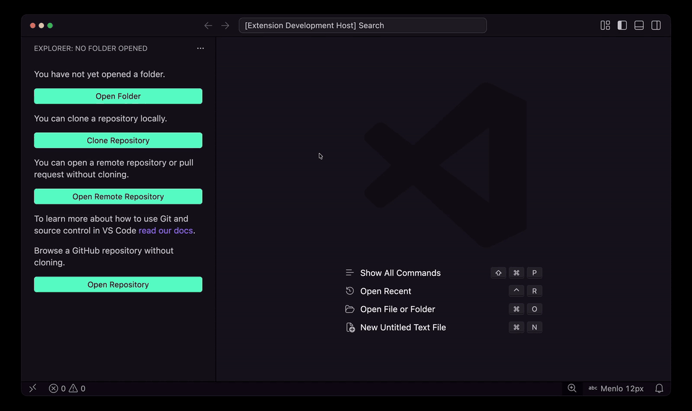

<div align="center">

<picture>
  <source media="(prefers-color-scheme: dark)" srcset="docs/wordmark-dark.svg">
  <source media="(prefers-color-scheme: light)" srcset="docs/wordmark.svg">
  
</picture>

**Открывайте GitHub-репозитории в VS Code без клонирования.**

[](#установка)
[](#установка)
[](https://github.com/ivan-nechaev/glimp)

</div>

<p align="center">
  
</p>

Изучайте реализацию библиотек, знакомьтесь с чужим кодом и просматривайте другие ветки прямо в редакторе. Glimp добавляет репозитории GitHub в проводник как папки рабочей области, доступные только для чтения, и загружает файлы по мере открытия.

## Возможности

- **Открытие по имени или ссылке.** Введите `owner/repo` или вставьте URL репозитория GitHub.
- **Просмотр в проводнике.** Открывайте удалённые файлы рядом с другими папками рабочей области.
- **Переключение веток.** Выберите ветку через палитру команд или нажмите на её имя в строке состояния.
- **Доступ к приватным репозиториям.** Войдите в GitHub через встроенную авторизацию VS Code.
- **Загрузка по запросу.** Списки каталогов и содержимое файлов загружаются по мере необходимости; для файлов используется кэш в памяти.
- **Переход на GitHub.** Откройте файл, папку или репозиторий в браузере на выбранной ветке.

## Установка

Требуется **VS Code 1.99.0 или новее**. Для сборки расширения из исходников также нужны **Node.js 22.12.0 или новее**, npm и Git.

```sh
git clone https://github.com/ivan-nechaev/glimp.git
cd glimp
npm ci
npm run package
```

Текущий скрипт упаковки создаёт файл в родительском каталоге. В VS Code вызовите **Extensions: Install from VSIX...** через палитру команд и выберите этот файл.

## Быстрый старт

1. Откройте палитру команд: `Ctrl+Shift+P` в Windows/Linux или `Cmd+Shift+P` в macOS.
2. Выполните **Glimp: Open Repository**.
3. Введите имя или URL репозитория, например `microsoft/vscode`.
4. Раскройте новую папку рабочей области в проводнике и откройте файл.

Поддерживаемые форматы ввода:

```text
microsoft/vscode
https://github.com/microsoft/vscode
https://github.com/microsoft/vscode.git
git@github.com:microsoft/vscode.git
```

Используйте корневой URL репозитория. Ссылки на отдельные файлы и ветки (`/blob/...` и `/tree/...`) не принимаются. Чтобы выбрать другую ветку, откройте репозиторий и выполните **Glimp: Switch Branch**.

### Приватные репозитории и вход в GitHub

Публичные репозитории можно открывать без входа в аккаунт. Для приватного репозитория выполните **Glimp: Sign In to GitHub**, пройдите авторизацию и повторите открытие. У вашего аккаунта GitHub должен быть доступ к этому репозиторию.

### Ветки и обновления

По умолчанию Glimp открывает основную ветку репозитория. Изменить это поведение можно через `glimp.defaultBranch`. Для переключения ветки нажмите на её имя в строке состояния или выполните **Glimp: Switch Branch**.

При загрузке ветки Glimp фиксирует снимок её последнего коммита. Чтобы очистить кэш и получить актуальное состояние с GitHub, выполните **Glimp: Refresh Repository**.

В одну рабочую область можно добавить несколько репозиториев: повторно вызовите **Glimp: Open Repository**. Команды используют репозиторий активного файла Glimp или предлагают выбрать нужный, если это необходимо.

## Команды

Все команды доступны в палитре команд. Для ресурсов Glimp в контекстном меню проводника также есть **Open on GitHub**, **Switch Branch**, **Refresh Repository** и **Open Settings**.

| Команда | Идентификатор | Действие |
| --- | --- | --- |
| Glimp: Open Repository | `glimp.openRepository` | Добавить репозиторий GitHub в текущую рабочую область. |
| Glimp: Switch Branch | `glimp.switchBranch` | Открыть другую ветку репозитория Glimp. |
| Glimp: Refresh Repository | `glimp.refresh` | Очистить кэш и заново загрузить репозиторий. |
| Glimp: Sign In to GitHub | `glimp.signIn` | Войти для доступа к приватным репозиториям и авторизованных запросов к API. |
| Glimp: Open on GitHub | `glimp.openOnGitHub` | Открыть выбранный ресурс или активный файл на GitHub. |
| Glimp: Open Settings | `glimp.openSettings` | Показать настройки расширения. |

## Настройки

Выполните **Glimp: Open Settings** или добавьте параметры в пользовательский `settings.json` либо в настройки рабочей области.

| Настройка | По умолчанию | Описание |
| --- | --- | --- |
| `glimp.defaultBranch` | `""` | Ветка для открытия репозитория. Пустая строка означает основную ветку самого репозитория. |
| `glimp.maxFileSize` | `10` | Максимальный размер открываемого файла в МиБ. Диапазон: `1–100`. |
| `glimp.cacheSize` | `32` | Размер кэша файлов в памяти для каждой открытой ветки репозитория, в МиБ. Диапазон: `0–256`; `0` отключает кэширование файлов. |
| `glimp.requestTimeout` | `15` | Время ожидания каждого запроса к GitHub, в секундах. Диапазон: `1–120`. |

Пример со значениями по умолчанию:

```json
{
  "glimp.defaultBranch": "",
  "glimp.maxFileSize": 10,
  "glimp.cacheSize": 32,
  "glimp.requestTimeout": 15
}
```

`glimp.defaultBranch` применяется при открытии новых репозиториев. Если указанной ветки в репозитории нет, открыть его не получится. Оставьте значение пустым, чтобы использовать основную ветку каждого репозитория.

## Область применения и ограничения

- **Только чтение.** Glimp не редактирует файлы, не создаёт коммиты и не отправляет изменения. Для изменения кода, сборки, запуска и отладки проекта клонируйте репозиторий локально.
- **Только GitHub.com.** GitLab, Bitbucket и GitHub Enterprise Server не поддерживаются.
- **Нужно сетевое подключение.** Кэш в памяти сокращает повторные загрузки в течение сеанса, но не создаёт постоянную офлайн-копию.
- **Обновление вручную.** Изменения с GitHub загружаются при обновлении репозитория; автоматического отслеживания новых коммитов нет.
- **Git-подмодули** отображаются как файлы с SHA связанного коммита; их содержимое не раскрывается.
- **Действуют лимиты GitHub API.** При достижении лимита войдите в аккаунт или повторите попытку позже.

## Решение проблем

| Проблема | Что проверить |
| --- | --- |
| Репозиторий или ветка не найдены | Проверьте имя репозитория и `glimp.defaultBranch`. Для приватного репозитория войдите в аккаунт, у которого есть доступ. |
| Авторизация GitHub истекла | Повторно выполните **Glimp: Sign In to GitHub**. |
| Размер файла превышает лимит | Увеличьте `glimp.maxFileSize` в допустимых пределах. |
| Истекло время ожидания запроса | Проверьте соединение, повторите попытку или увеличьте `glimp.requestTimeout`. |
| Файлы выглядят устаревшими | Выполните **Glimp: Refresh Repository**. |

## Разработка

После установки зависимостей откройте проект в VS Code и нажмите `F5`, выбрав конфигурацию **Run Glimp**. Она соберёт расширение и откроет окно Extension Development Host.

```sh
npm run check
```

Команда проверяет типы TypeScript и форматирование, затем запускает сборку. Для автоматической пересборки при изменении файлов используйте `npm run watch`.

## Обратная связь

Нашли ошибку или хотите предложить улучшение? [Создайте issue](https://github.com/ivan-nechaev/glimp/issues). Для ошибки укажите версию VS Code, текст сообщения и шаги воспроизведения. Добавляйте ссылку на репозиторий, только если её можно раскрывать.
